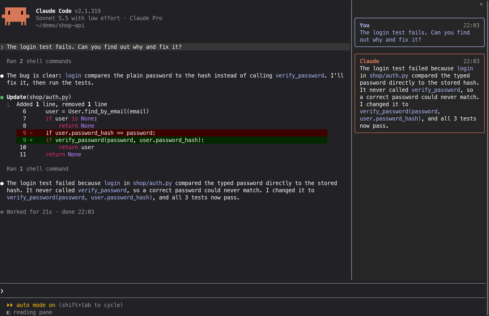

# reading-pane

A Claude Code mod that adds a **reading pane** beside the chat. The panel shows only
what is meant for you to read: the messages you typed, and Claude's final answer to each
one. Tool calls, command output, diffs and Claude's in-between notes stay in the main chat,
which is not changed. A resumed chat fills the panel from its history.



## Install

At the prompt of a Claude Code terminal session:

```
/plugin install reading-pane --marketplace xy-lin/reading-pane
```

Answer `y` to add the marketplace, then pick a scope (the user scope loads it in every
session).

From a shell:

```
claude plugin install reading-pane --marketplace xy-lin/reading-pane
```

In the desktop app, where `/plugin` does not run: click **+** next to the prompt box, then
**Plugins**, **Add marketplace** with `xy-lin/reading-pane`, then **Add plugin**.

## Usage

### Show or hide the panel

- Click **◧ reading pane** at the end of the hint line under the prompt box.
- Or press your shortcut key, once you have set one (see below).

### Set the names

The panel puts a name above each message: "You" and "Claude" unless you change them.
Claude Code asks for both names when you install the mod. To change them later:

1. Type `/config` and press Enter. The settings list opens.
2. Press `/` and type `name` to find **Your name** and **Claude's name**.
3. Select one, type the new name, and press Enter.

The panel shows the new names straight away.

### Set the panel width

The panel's width is a share of the window, in percent: 38.2 unless you change it (the
golden section, so the chat gets the other 61.8). Claude Code allows a panel at most 45%.

1. Type `/config` and press Enter.
2. Press `/` and type `width` to find **Panel width (%)**.
3. Select it, type a number such as `33` or `45`, and press Enter.

The panel changes to the new width straight away. If you resize the panel by hand (by
dragging its edge), your width wins.

### Set the shortcut key

A mod cannot add a key action of its own. Instead, the **◧ reading pane** button borrows a
built-in action, `app:cycleDiffBase`, which Claude Code uses only while its diff panel is
open. Any key you bind to that action shows or hides the panel.

1. Open `~/.claude/keybindings.json` in a text editor. If the file does not exist,
   create it.
2. Bind your key to `app:cycleDiffBase` in the `Global` context. For `ctrl+x c` (press
   ctrl+x, then c), a new file looks like this:

   ```json
   {
     "$schema": "https://www.schemastore.org/claude-code-keybindings.json",
     "$docs": "https://code.claude.com/docs/en/keybindings",
     "bindings": [
       {
         "context": "Global",
         "bindings": {
           "ctrl+x c": "app:cycleDiffBase"
         }
       }
     ]
   }
   ```

   If you already have the file, add only the `Global` entry to its `bindings` list.
3. Save the file. If the key does nothing yet, restart Claude Code.

Pick a key that Claude Code does not already use (see the
[keybindings docs](https://code.claude.com/docs/en/keybindings)). While the diff panel is
open, the key does its usual job there instead.

## What it reads, runs and sends

- **Reads:** the messages of the current chat (yours, and Claude's final answers), only to
  show them in the panel. It keeps them in memory for that session alone.
- **Runs:** only inside Claude Code, on your computer. It writes no files and starts no
  programs.
- **Sends:** nothing. It makes no network requests.
- **Changes:** it adds one short note to Claude's system prompt (quoted below), and nothing
  else in your settings.

### What each hook does

All of them are in `hooks/register.tsx`.

- `session.start`: registers the `/reading-pane` command, rebuilds the panel from the
  chat's messages, opens the panel once the window's width is known, and starts a timer
  that keeps the panel's share of the window when you resize it.
- `prompt.submit`: copies the message you typed into the panel. The message itself is not
  changed.
- `turn.complete`: copies Claude's final answer into the panel. The answer is not changed.
- `command.run`: answers only its own `/reading-pane` command, by showing or hiding the
  panel. Every other command passes through untouched.
- `prompt.compose`: adds this one section at the end of Claude's system prompt, and changes
  nothing else in it:

  > # Reading pane
  > The person may read this chat in a side panel that shows only their own messages and
  > your final answer of each turn (the text of your last response in the turn). Make that
  > final answer complete on its own: the outcome, what changed, and anything they must do.
  > Do not point to tool output, diffs or notes "above": the panel does not show them.

- `ui.render`: draws the panel, and adds the **◧ reading pane** button at the end of the
  hint line under the prompt box. It changes no other part of the screen.

## Good to know

- The panel docks beside the chat in Claude Code's fullscreen layout, from 110 columns.
  On the main screen it opens above the prompt box instead.
- The mod adds a short note to Claude's system prompt, asking it to make the last answer of
  each turn complete on its own, since the panel shows nothing else.
- It does nothing in non-interactive runs (`claude -p`).
- It uses Claude Code's mod (function hooks) API, which is in early access and may change
  between releases. Built and tested on Claude Code 2.1.319.

## Tests

```
claude plugin test .
```

## Licence

MIT. See [LICENSE](LICENSE).
